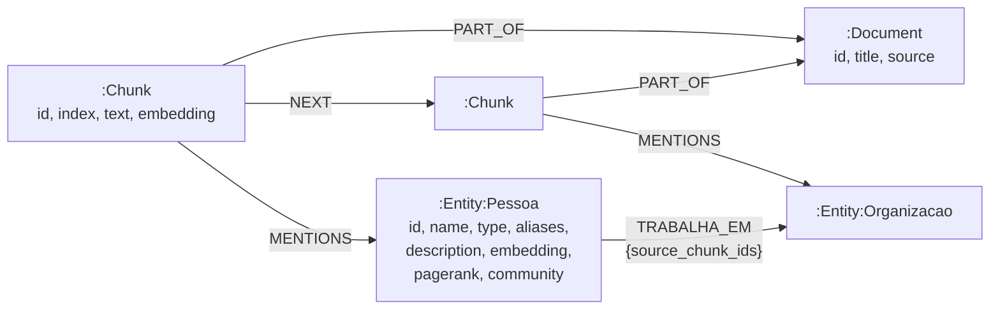

# Modelo do grafo (LPG no Neo4j)

Responsável: Nicolas. Requisitos: R03 a R09 e R20.

Este é o **schema base**, que não depende do domínio. Quando a equipe escolher o domínio e o dataset, falta preencher a seção [Rótulos e relações do domínio](#rótulos-e-relações-do-domínio-a-definir). O resto já está implementado em `neo4j/schema/`.

## Visão geral

O grafo tem duas camadas ligadas entre si:

- **Grafo léxico:** os documentos originais quebrados em trechos (`Chunk`), cada um com seu embedding. É daqui que sai a busca vetorial e a procedência.
- **Grafo de domínio:** as entidades e relações extraídas pelo LLM. É aqui que acontece a travessia multi-hop e onde rodam os algoritmos do GDS.

A ligação entre as camadas (`MENTIONS` e `source_chunk_ids`) funciona como um índice nos dois sentidos: dá para ir de um trecho para as entidades que ele cita e de uma relação para os trechos que a justificam. É o que permite o grounding (R21) e a exibição de procedência (R28), e é a ideia de indexação mútua do KAG.



`Pessoa`, `Organizacao` e `TRABALHA_EM` são só exemplos. Os rótulos e relações reais dependem do domínio.

## Nós

| Rótulo | Propriedades | Observações |
|---|---|---|
| `Document` | `id` (único), `title`, `source` | Um por arquivo do dataset. `source` guarda a origem (URL ou caminho). |
| `Chunk` | `id` (único), `index`, `text`, `embedding` | Trecho do documento. `index` é a posição dentro do documento. |
| `Entity` + rótulo do domínio | `id` (único), `name`, `type`, `aliases`, `description`, `embedding`, `pagerank`, `community` | `id` é a forma canônica gerada pela resolução de entidades, ex.: `pessoa:maria_silva`. `type` repete o rótulo do domínio. `pagerank` e `community` são gravados pelo GDS. |

## Relações

| Tipo | De → Para | Propriedades | Para que serve |
|---|---|---|---|
| `PART_OF` | `Chunk` → `Document` | | Saber de qual documento veio cada trecho |
| `NEXT` | `Chunk` → `Chunk` | | Expandir o contexto para o trecho vizinho |
| `MENTIONS` | `Chunk` → `Entity` | | Ligar texto e grafo (procedência e busca híbrida) |
| relações do domínio | `Entity` → `Entity` | `source_chunk_ids` | Fatos extraídos. `source_chunk_ids` lista os trechos que justificam a relação. |

## Constraints e índices

| Nome | Tipo | Alvo | Requisito |
|---|---|---|---|
| `document_id_unique` | Unicidade | `Document.id` | R05 |
| `chunk_id_unique` | Unicidade | `Chunk.id` | R05 |
| `entity_id_unique` | Unicidade | `Entity.id` | R05, R12 |
| `entity_name`, `entity_type`, `entity_pagerank`, `entity_community`, `document_source` | Range | propriedades usadas em filtros e ordenação | R06 |
| `entity_search` | Fulltext | `Entity.name`, `aliases`, `description` | R07 |
| `chunk_text` | Fulltext | `Chunk.text` | R07 |
| `chunk_embedding` | Vector (cosseno) | `Chunk.embedding` | R08 |
| `entity_embedding` | Vector (cosseno) | `Entity.embedding` | R08 |

Para conferir no banco (evidência para o artigo):

```cypher
SHOW CONSTRAINTS;
SHOW INDEXES;
```

## Algoritmos de grafo (R20)

Rodam sobre uma projeção só com os nós `Entity` e as relações entre eles, depois da ingestão:

```bash
docker compose run --rm neo4j-gds
```

- **PageRank** → `Entity.pagerank`: importância da entidade. Usado para ranquear o que entra no contexto do LLM.
- **Louvain** → `Entity.community`: comunidade (tema). Usado para enriquecer o contexto e colorir o subgrafo na interface.
- **Caminho mais curto:** feito em Cypher na hora da pergunta (consulta 4 de `neo4j/consultas/exemplos.cypher`).

## Decisões de modelagem (para o artigo)

1. **Rótulo genérico `Entity` + rótulo do domínio.** Uma única constraint em `Entity.id` impede duplicatas de qualquer tipo, e os índices fulltext e vetorial cobrem todas as entidades de uma vez. O rótulo do domínio (`Pessoa`, `Organizacao`...) continua disponível para as consultas Cypher geradas pelo LLM.
2. **Procedência na própria relação.** `source_chunk_ids` evita criar um nó intermediário para cada fato e mantém a travessia multi-hop curta.
3. **Range em vez de BTree.** O enunciado pede BTree/Range. No Neo4j 5 o índice BTree foi removido e substituído pelo Range.
4. **Limites da edição Community.** Constraints de existência (`IS NOT NULL`), de tipo e `NODE KEY`, além de usuários com papéis (só leitura), são exclusivos da Enterprise. A obrigatoriedade das propriedades fica a cargo da ingestão e dos testes. A proteção contra escrita nas consultas geradas pelo LLM é feita executando-as em transação de leitura (o banco recusa qualquer escrita).
5. **Versão fixa.** Neo4j 5.26.32 (LTS) com APOC e GDS 2.13.14, embutidos numa imagem Docker própria. Assim toda a equipe roda exatamente o mesmo banco, e o plugin não é baixado de novo a cada inicialização.

## Rótulos e relações do domínio (a definir)

Preencher na primeira reunião, junto com o Patrick (o prompt de extração usa esta lista, R13):

| Rótulo do domínio | Descrição | Exemplo |
|---|---|---|
| | | |

| Relação | De → Para | Descrição | Exemplo de pergunta multi-hop que ela habilita |
|---|---|---|---|
| | | | |
